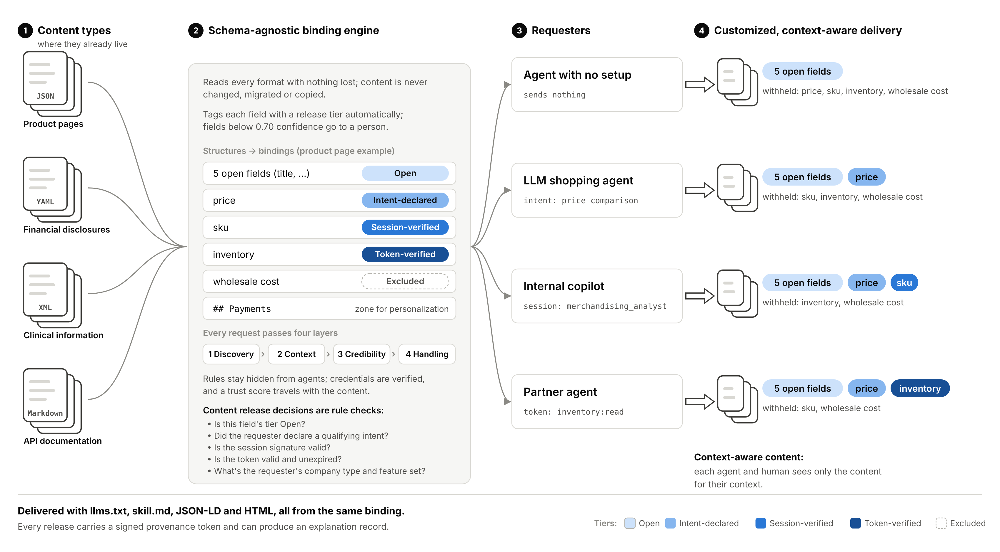

# One Content Source, Customized For Every Requester Context

***Give every agent and every person exactly the content they're entitled to, tailored to them, with a record of why.***

**TL;DR:** A patent-pending governance layer that sits on top of existing content, without migrating or copying it. It tags every field automatically, releases each field in one of five tiers based on what the requester declares and can prove, tailors the content to each requester's context, and records every decision. The result is content agents can find, trust and act on, a direct answer to agent search optimization. We're looking for a partner to pilot and co-develop it.

**Audience:** Content, platform, commerce and compliance leaders · **Reading time:** about 3 minutes

**Status:** Patent pending, U.S. provisional application filed in 2026 · Non-confidential overview

## The problem

AI agents now read enterprise content directly: product data, pricing, documentation, disclosures. They increasingly decide what people see, compare and buy, so making content visible and trustworthy to agents, **agent search optimization**, is becoming an industry-wide challenge. Most content systems weren't built for this, and often the choice is all or nothing:

- **Invisible or uncontrolled in agent answers.** Agents recommend what they can read and trust; blocked or unstructured content drops out of their answers.
- **Publish it and lose control.** An agent that reads the public page gets everything on it, with no say over what it's used for.
- **Block it and lose the business.** Shopping agents, partner integrations and internal copilots can't get the content they legitimately need.
- **Copy it to tailor it.** Giving each customer its own version means maintaining duplicate documents that drift out of date.
- **No record of why.** When an agent gets a field, nobody can say what entitled it to, or prove it afterward.

## The approach

1. **Bind governance to content where it already lives.** Any format (JSON, YAML, XML, Markdown) is read with nothing lost or changed. A model proposes a release tier for every field, and each customer reviews and approves its own mapping.
2. **Release each field by what the requester declares and proves.** Five tiers run from open to excluded, each with its own requirement. An agent with no setup gets the open fields, an agent that declares its purpose gets more, and verified sessions or partner tokens unlock the most sensitive fields. Every release decision is a deterministic rule check that can be certified.
3. **Tailor content to each requester's context.** Each company's agent sees only the APIs it implemented and the features it has enabled, generated per request from one source document.
4. **Deliver every format from one binding, with oversight built in.** llms.txt, skill.md, JSON-LD and HTML all come from the same governed decision, giving agents structured, consistent content with trust metadata, which is what agent search optimization needs. A provenance record travels with the content, and oversight tools catch tampering and unreviewed schema changes.

*Select the diagram to open it full size.*

## What a working demonstration shows

A simulated set of twelve companies, four content genres and four formats, with every result checked against each customer's allowed tiers:

| Result | Simulated outcome |
|---|---|
| **Content used as it is** | All 276 content objects read with nothing lost or changed, across four formats |
| **Less tagging work, fewer errors** | 90% of fields tagged automatically; hand-written keyword scripts leaked 44 fields, the model with each customer's review leaked 1 |
| **Each customer sets its own rules** | Customers changed proposals to match their own policies, and a strict customer's 0.95 threshold produced 0 leaks |
| **Enforcement holds** | 5,000 random requests, including forged and expired credentials, with 0 enforcement errors |
| **Context-aware content** | Each company's agent got exactly its own APIs and enabled features, from one source: 1 document to maintain instead of 27 copies |
| **Better than other content frameworks** | 99% of entitled fields delivered and none released without entitlement; page-level controls released 811 fields without entitlement |
| **Every decision explained** | Reason codes, counterfactuals and a custody chain for every release; tampering and unreviewed schema changes caught before they ship |

Results are from simulated data and show the method working, not results for any real company.

## The value to a partner

- **Agent search optimization,** with structured, trustworthy content agents can find, cite and act on, without giving up control
- **Agents become a channel, not a risk,** because they get more content by declaring intent or proving identity
- **No migration and no tagging project,** because governance sits on top of existing content and the model drafts the mapping
- **One source for every customer,** with tailored content and no duplicate copies to keep in sync
- **Audit-ready releases** for compliance, disputes and partner agreements
- **A differentiated capability** for content, commerce, documentation and agent platforms

## Next step

A 30-minute call to walk through the working demonstration and discuss a pilot on one content type you already serve to agents.

**Contact:** rjslogar@gmail.com
